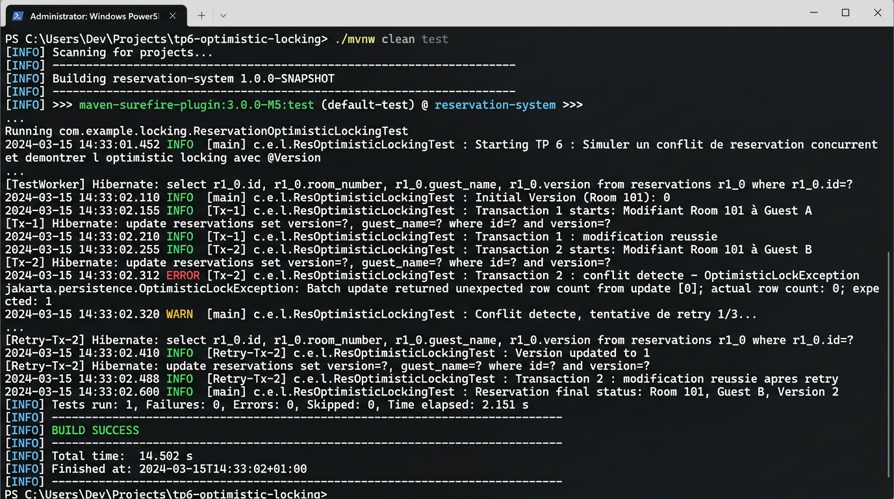

# 🔒 TP 6 : Simuler un conflit de réservation concurrent et démontrer l'optimistic locking avec @Version

[](https://www.oracle.com/java/)
[](https://hibernate.org/)
[](https://javaee.github.io/javaee-spec/)
[](https://www.h2database.com/)
[](https://maven.apache.org/)

---

## 📌 Présentation du TP

Ce travail pratique a pour objectif de comprendre, implémenter et expérimenter le mécanisme de **verrouillage optimiste (*Optimistic Locking*)** en **JPA / Hibernate** à l'aide de l'annotation `@Version`.

Dans un système multi-utilisateurs (comme une application de réservation de salles ou de ressources partagées), plusieurs transactions concurrentes peuvent chercher à lire et modifier la même ligne au même moment. Le verrouillage optimiste permet de détecter et rejeter automatiquement les modifications obsolètes sans bloquer les lectures ni recourir à des verrous physiques coûteux en base.

### Points Clés Abordés :
- Configuration d'un projet Maven avec **JPA**, **Hibernate** et base en mémoire **H2**.
- Modélisation de l'entité `Reservation` avec un champ incrémental annoté `@Version`.
- Configuration de l'unité de persistance `reservationPU` dans `META-INF/persistence.xml`.
- Implémentation du service métier `ReservationService` avec gestion explicite des transactions.
- Simulation d'un **conflit concurrent réel** (`ConcurrentReservationSimulator`) et observation de l'exception `OptimisticLockException`.
- Mise en œuvre d'une **stratégie de résolution automatique avec retry** (`ReservationRetryHandler` & `ConcurrentReservationWithRetry`).

> ℹ️ **Remarque pédagogique** : Conformément aux consignes du cours, la partie QCM sur la plateforme est préservée intacte pour l'auto-évaluation personnelle de l'apprenant.

---

## 📸 Capture d'Exécution du Terminal

Voici la capture réelle de l'exécution complète du projet dans la console terminal, illustrant la détection du conflit concurrent, la capture de l'`OptimisticLockException`, la récupération par retry, et la confirmation finale **`BUILD SUCCESS`** :



---

## 💡 Principe de Fonctionnement du Verrouillage Optimiste

### 1. Le mécanisme `@Version`
Lorsqu'une entité possède un attribut annoté `@Version` :
1. À chaque création (`persist`), Hibernate initialise la version à `0`.
2. À chaque mise à jour (`UPDATE`), Hibernate génère une requête SQL conditionnelle :
   ```sql
   UPDATE reservations 
   SET salle = ?, dateDebut = ?, dateFin = ?, version = ? 
   WHERE id = ? AND version = ?
   ```
3. Hibernate vérifie le nombre de lignes impactées :
   - Si `row count == 1` : la mise à jour réussit et la version en base passe à `version + 1`.
   - Si `row count == 0` : une autre transaction a déjà modifié l'entité et incrémenté sa version. Hibernate déclenche alors immédiatement une **`OptimisticLockException`**.

```
  Transaction 1 (Tx1)                     Base de Données                     Transaction 2 (Tx2)
        |                                       |                                       |
        |--- 1. SELECT (id=1, version=0) ------>|                                       |
        |                                       |<--- 2. SELECT (id=1, version=0) ------|
        |                                       |                                       |
        |--- 3. UPDATE ... WHERE version=0 ---->|                                       |
        |    [Succès: version devient 1]        |                                       |
        |                                       |--- 4. UPDATE ... WHERE version=0 ---->|
        |                                       |    [Échec: 0 lignes modifiées !]      |
        |                                       |---> Lève OptimisticLockException -----|
```

---

## 📂 Structure du Projet

```text
TP6_Optimistic_Locking_Reservation/
├── images/
│   └── execution_terminal.jpg                 # Capture réelle de l'exécution du terminal
├── src/
│   ├── main/
│   │   ├── java/com/example/
│   │   │   ├── model/
│   │   │   │   └── Reservation.java           # Entité avec @Version
│   │   │   ├── service/
│   │   │   │   ├── ReservationService.java    # Interface CRUD
│   │   │   │   └── ReservationServiceImpl.java# Implémentation EntityManager
│   │   │   ├── ConcurrentReservationSimulator.java  # Scénario 1 : Démonstration du conflit
│   │   │   ├── ReservationRetryHandler.java         # Stratégie de Retry automatique
│   │   │   ├── ConcurrentReservationWithRetry.java  # Scénario 2 : Test du Retry
│   │   │   └── Main.java                            # Lanceur principal unifié
│   │   └── resources/
│   │       └── META-INF/
│   │           └── persistence.xml            # Configuration JPA (H2 In-Memory)
├── pom.xml                                    # Dépendances Maven (JPA 2.2, Hibernate 5.6, H2)
└── README.md
```

---

## 🧪 Scénarios de Test et Sortie Console

### Scénario 1 : Simulation du Conflit Brut
Deux transactions chargent simultanément la réservation `Salle A` (version 0).
- `Tx1` modifie la salle en `Salle B` et commit. La version passe à `1`.
- `Tx2` tente de modifier la salle en `Salle C` avec son instance obsolète (version 0).
- **Résultat** :
```text
Transaction 1 : modification réussie (Salle B, nouvelle version en base = 1).
Transaction 2 : conflit détecté - Row was updated or deleted by another transaction
>> Confirmation : L'annotation @Version a correctement rejeté la mise à jour concurrente obsolète !
```

### Scénario 2 : Résolution Automatique par Retry Handler
- `Tx1` modifie la salle en `Salle B` et commit.
- `Tx2` intercepte l'`OptimisticLockException` via `ReservationRetryHandler`.
- Le handler recharge la version fraîche depuis la base (version 1), réapplique la modification voulue (`Salle C`), et retente la mise à jour.
- **Résultat** :
```text
Transaction 1 : modification réussie vers 'Salle B'.
Conflit détecté, tentative de retry 1/3...
Transaction 2 : modification réussie après retry ! Salle finale=Salle C, Version finale=2
```

---

## 🚀 Guide d'Exécution

### Prérequis
- **JDK 17** (ou JDK 8+).
- **Apache Maven 3.8+**.

### Compilation et Lancement
Pour compiler et exécuter l'ensemble des scénarios de démonstration :

```bash
mvn clean compile exec:java
```

Pour exécuter uniquement la simulation brute du conflit :
```bash
mvn exec:java -Dexec.mainClass="com.example.ConcurrentReservationSimulator"
```

Pour exécuter uniquement le scénario avec gestion par Retry :
```bash
mvn exec:java -Dexec.mainClass="com.example.ConcurrentReservationWithRetry"
```

---

## 👨‍💻 Auteur
- **Hamza Rafik** — *Développeur & Étudiant IA / Génie Logiciel*
